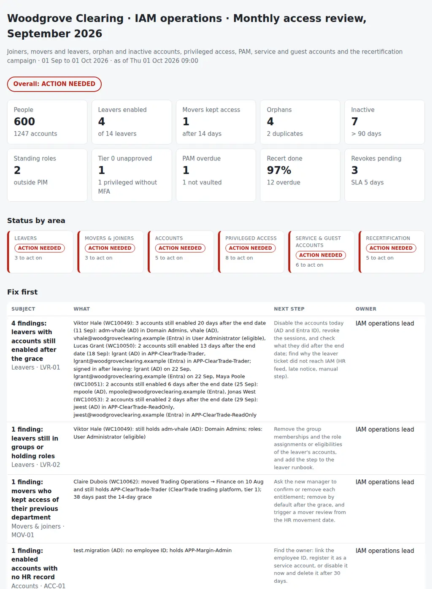

# IAM Access Review

The monthly identity and access review of an IT operations or IAM service team: joiners, movers and leavers (JML), the accounts nobody owns, privileged access and the recertification campaign. From the HR roster and the Active Directory, Entra ID and PAM exports it puts together:

- **Leavers:** accounts still enabled after the end date and its grace, sign-ins after leaving, and the groups, admin accounts and directory roles they still hold.
- **Movers and joiners:** access of the previous department kept beyond the grace, access before the start date, joiners without a manager.
- **Accounts:** enabled accounts with no HR record, duplicate employee IDs, accounts inactive for more than 90 days, human passwords that never expire.
- **Privileged access:** standing Entra ID roles outside PIM, privileged users without MFA or unused, Tier 0 group members beyond the approved list, vaulted passwords not rotated and admin accounts not vaulted.
- **Service and guest accounts:** service accounts whose owner left or that sign in interactively, guests inactive or without a sponsor.
- **Recertification:** items not reviewed by the due date, revokes not actioned, reviewers approving everything in minutes, and entitlements overdue for review by sensitivity tier.

Nine exports, one JSON with the policy and one Python command give each area a status (**clean**, **follow up** or **action needed**), an overall status, and the pack for the monthly IAM service review, with the controls written the way an auditor tests them.

Python 3.10+, standard library only. It runs with fictional demo data out of the box. A read-only PowerShell exporter for Active Directory (ActiveDirectory module) and Entra ID (Microsoft Graph PowerShell) is included.



## Why

Access reviews are usually a spreadsheet sent to managers once a quarter and a box ticked for the auditor. Meanwhile, the things that would make an incident are in plain sight in the exports:

- a systems administrator left three weeks ago, and his admin account is still enabled and in Domain Admins;
- a trader signed in four days after his last day;
- an analyst moved from trading to finance in August, kept the trading platform, and the platform owner approved it in the campaign;
- a Global Administrator was assigned directly in June, permanently, outside PIM;
- the SQL Server service account password in the vault has not changed in 200 days;
- the batch service account belongs to someone who left in August, and somebody signed in with it interactively last week;
- one reviewer approved 140 items in three minutes, and three revokes from the campaign were never actioned.

HR knows who left and who moved, the directories know who can still sign in, the vault knows what was rotated, and the campaign knows who said what. The review that matters joins them per person and per account, every month, against the policy the team signed up to. The rules are in `settings.json` and `iamreview/checks.py`.

## What it checks

| Area | Code | Finding |
|---|---|---|
| Leavers | LVR-01 | Leaver with an AD or Entra ID account still enabled after the end date plus `leaver_grace_days` (with the sign-ins after leaving); critical |
| Leavers | LVR-02 | Leaver still in tier 0 to 2 groups or holding directory roles (eligible included); critical for Tier 0 or roles |
| Movers & joiners | MOV-01 | Mover still holding entitlements tagged to the previous department after `mover_grace_days`; critical for tier 0 and 1 |
| Movers & joiners | JNR-01 | Joiner with sign-ins or sensitive access before the start date, or a grant dated before it |
| Movers & joiners | JNR-02 | Joiner without a manager in HR, or with a manager who left |
| Accounts | ACC-01 | Enabled account with no HR record (no employee ID or one HR does not know), and unregistered service accounts; critical with sensitive access |
| Accounts | ACC-02 | Employee ID on two standard accounts in the same directory, or twice in HR |
| Accounts | ACC-03 | Enabled account with no sign-in for `inactive_days` (the most recent of AD and Entra ID), or never used |
| Accounts | ACC-04 | Human or admin account with a password that never expires, unless vaulted with rotation |
| Privileged access | PRV-01 | Standing (active, not activated) assignment of a role in `pim_roles`; critical for `critical_roles`; break-glass for information |
| Privileged access | PRV-02 | Privileged account without MFA registered (critical) or without sign-in for `privileged_inactive_days` |
| Privileged access | PRV-03 | Tier 0 group member not on `approved_tier0`; critical |
| Privileged access | PAM-01 | Vaulted password older than the rotation policy (critical over twice), or automatic management off |
| Privileged access | PAM-02 | Tier 0, admin or break-glass account not in the vault |
| Service & guest accounts | SVC-01 | Service account without an owner, with an owner HR does not know, or whose owner left (critical while enabled) |
| Service & guest accounts | SVC-02 | Interactive sign-in allowed, or seen when the register says not allowed (critical) |
| Service & guest accounts | GST-01, GST-02 | Guest inactive for `guest_inactive_days`; guest without a sponsor |
| Recertification | REC-01 | Item without a decision after the due date; critical for tier 0 and 1 |
| Recertification | REC-02 | Revoke not removed within `revoke_sla_days`; critical while the user is still a member |
| Recertification | REC-03 | Rubber-stamping: a reviewer with at least `rubber_min_items` decisions, all approved, in under `rubber_max_minutes` |
| Recertification | REC-04 | Entitlement not certified within the frequency of its tier; critical for tier 0 and 1 |
| Accounts, Recertification | MET-01, MET-02 | Population, JML counts and campaign completion (for information) |

## Outputs

| File | What |
|---|---|
| `report.html` | Overall status, tiles, status by area, "Fix first", leavers, movers and joiners, accounts, privileged access (roles, Tier 0, MFA, vault), PAM, service accounts, guests, recertification by reviewer, revokes not actioned, entitlements by tier, all findings |
| `access-review.md` | The pack for the monthly IAM service review: summary, scope and evidence (sources and record counts), policy parameters, 13 controls with population, exceptions and result, exceptions by control, actions, recertification by reviewer, notes for the auditor and sign-off |
| `leavers.csv` | Every leaver of the period and any older one with access left: accounts, enabled ones, last sign-in, sign-ins after leaving, groups and roles |
| `movers.csv` | Every mover of the period: from and to, grace, entitlements kept |
| `orphans.csv` | Accounts with no HR record and duplicate employee IDs |
| `privileged.csv` | Every role assignment (active, activated, eligible), every Tier 0 member and every vault entry, with person, MFA, last sign-in and vault status |
| `service-accounts.csv` | Registered and unregistered service accounts: owner and owner status, interactive sign-in, vault |
| `recert.csv` | Every campaign item with its status (approved, revoke pending N days, no decision overdue) and the rubber-stamp flag |
| `actions.csv`, `findings.csv` | The findings with owner and next step, ready for a tracker |

## Try it

```bash
git clone https://github.com/inigogonzalezgarcia/37-iam-access-review.git
cd 37-iam-access-review
python -m iamreview demo
```

Open `output/report.html` and `output/access-review.md`.

### The demo data

The demo is a made-up clearing house, Woodgrove Clearing, reviewed on Thursday 1 October 2026 for September:

- 600 people in 13 departments, 618 Active Directory and 629 Entra ID accounts (24 guests);
- 1,760 group memberships over a catalogue of 19 entitlements (Domain Admins, the trading and clearing platforms, the risk engine, SWIFT, SAP, shares…), 17 Entra ID role assignments, 15 vaulted accounts and 8 registered service accounts;
- the Q3 recertification campaign: 446 items, due 25 September.

All names, domains and addresses are fictional. The problems are placed on purpose:

- **Leavers:**
  - a systems administrator who left on 11 September, with his admin account still enabled in Domain Admins and a User Administrator eligibility;
  - a trader who signed in four days after his last day, with the trading platform;
  - two more leavers still enabled, and a disabled one still in the settlement system.
- **Movers and joiners:**
  - an analyst moved from Trading Operations to Finance on 10 August who kept the trading platform (approved in the campaign);
  - a risk analyst starting on 5 October who already signed in and holds the risk engine;
  - a joiner without a manager.
- **Accounts:** a migration test account with margin administration rights, an old compliance account and an unregistered `svc-ftp-legacy` with no HR record, a cloud-only audit account, a duplicate employee ID, seven accounts unused for months and six human passwords that never expire.
- **Privileged access:**
  - a Global Administrator assigned permanently in June, outside PIM, and a standing Exchange Administrator;
  - a Security Administrator without MFA, and an eligible Global Administrator unused for 73 days;
  - an admin account in Domain Admins that is neither approved nor vaulted;
  - the SQL Server service account not rotated in 200 days.
- **Service and guests:** the clearing batch account, owned by someone who left in August, allowed to sign in interactively and used that way on 27 September; a file transfer account signing in interactively against the register; four inactive guests and two without a sponsor.
- **Recertification:**
  - the head of Clearing Operations approved 140 items in three minutes;
  - the SWIFT operator role was never reviewed, and it is 105 days overdue;
  - three revokes not actioned, two of them still members;
  - Domain Admins overdue on its monthly review.

## Use it with your own data

1. Export Active Directory and Entra ID (read-only: only Get- cmdlets):
   ```powershell
   .\scripts\Export-AccessReviewData.ps1 -OutputFolder .\data -EntitlementCatalogue .\data\entitlements.csv -ForestRootServer dc01.corp.contoso.com
   ```
   - Active Directory: `Get-ADUser` with employeeID, LastLogonDate, PasswordLastSet, PasswordNeverExpires, whenCreated, memberOf and Description, and `Get-ADGroupMember -Recursive` for the catalogue and Tier 0 groups.
   - Entra ID: `Get-MgUser` with signInActivity (Entra ID P1 or P2), guest sponsors, MFA registration, role definitions, active role assignment instances and PIM eligibilities.
   - Graph permissions (delegated, read-only): User.Read.All, AuditLog.Read.All, RoleManagement.Read.Directory, and GroupMember.Read.All for cloud groups.
2. Add the files that live elsewhere: `hr.csv` from the HR system, `entitlements.csv` (your catalogue with tier, owner, department and frequency), `pam-accounts.csv` from the vault, `service-register.csv` and `recert-results.csv`.
3. Adjust `data/settings.json`: grace periods, thresholds, PIM roles, break-glass accounts and the approved Tier 0 list ([docs/data-format.md](docs/data-format.md)).
4. Build the outputs:
   ```bash
   python -m iamreview review data/ --title "Access review · September 2026"
   ```

[docs/monthly-access-review-runbook.md](docs/monthly-access-review-runbook.md) has the export, the order to work the critical findings on the day, the agenda of the monthly IAM service review and how to read each signal.

The exports contain names, employee IDs, accounts and privileges. Keep them inside your organisation:

- real files at the top level (`hr*.csv`, `ad-users*.csv`, `entra-users*.csv`, `memberships*.csv`, `entitlements*.csv`, `privileged-roles*.csv`, `pam-accounts*.csv`, `service-register*.csv`, `recert-results*.csv`, `settings.json`, `data/`) and the `output/` folder are excluded from Git by `.gitignore`;
- only the fictional files in `sample_data/` are committed.

## Tests

```bash
pip install -r requirements-dev.txt
python -m pytest -q
```

GitHub Actions runs them on Python 3.10 and 3.12 on every push, then rebuilds the fictional sample data and the report screenshot from the simulator.

18 tests: AD and Entra ID exports with raw FILETIME values, distinguished names, Graph column names and semicolons; HR files in Spanish, settings and the required files; leavers enabled after the grace and the groups and roles they keep; movers; joiners before their start date and without a manager; orphans, duplicates, inactivity and passwords that never expire; standing roles and break-glass; MFA, inactivity and Tier 0 approval; vault rotation and admin accounts outside the vault; service accounts and guests; overdue items and revokes; rubber-stamping and entitlements overdue by tier; status by area and overall; and the demo end to end (deterministic, all ten outputs).

## Next steps

- Read the HR roster and the PAM vault from their APIs, instead of two CSVs.
- Compare each month with the previous one in the pack: new exceptions, closed ones and the ones that stay open.
- Generate the next campaign from the catalogue (items due by tier, reviewer by owner or manager) with the last sign-in and department next to each item, so reviewers see what they approve.
- Check the break-glass accounts' sign-ins and the Conditional Access exclusions in the same run.

## Background

Built from my work in IT operations and identity:

- Active Directory and Windows Server, Entra ID with Azure AD Connect, and Microsoft 365 as Global Administrator;
- PIM and just-in-time access, Conditional Access, SAML single sign-on and App Registrations, and Keycloak;
- privileged accounts in CyberArk and ManageEngine Password Manager Pro;
- the joiner process (network, email and business applications from day one), owning the incident, request and change processes, and the CMDB;
- applying ISO 27001, GDPR and NIS2 and answering audits, with PowerShell and Microsoft Graph automation.

Written from scratch with fictional data; no employer data, systems or exports are used.

## Customisation and contact

Want this adapted to your team? For example:

- your HR feed, your entitlement catalogue and the tiers of your applications;
- your directories, PIM roles, break-glass accounts and Tier 0 list;
- your vault, your service account register and your recertification tool;
- the monthly pack for your IAM service review and your auditors.

Get in touch:

- Website (contact form): [inigogonzalezgarcia.github.io](https://inigogonzalezgarcia.github.io/about.html#contacto)
- LinkedIn: [linkedin.com/in/igonzalez93](https://www.linkedin.com/in/igonzalez93)

## License

MIT
